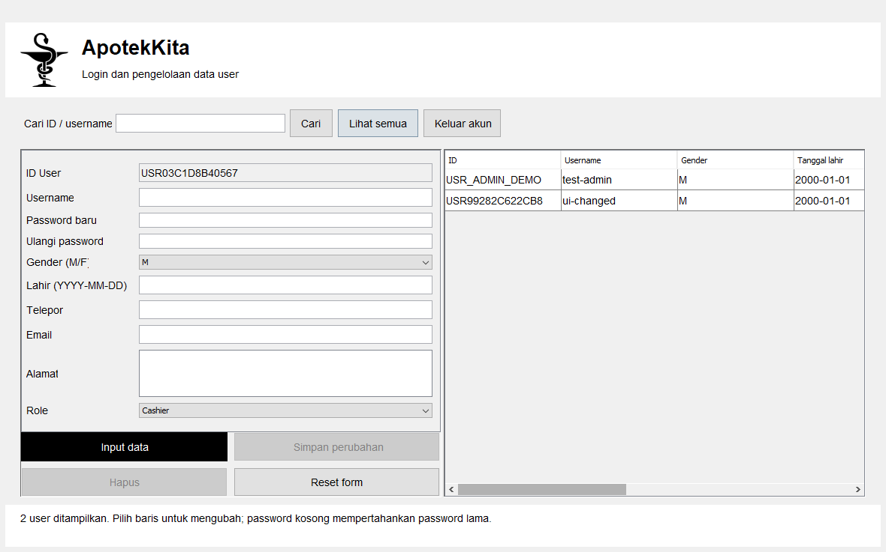

# ApotekKita Java

Aplikasi desktop Java Swing untuk login dan pengelolaan data user. Administrator dapat menambah, melihat, mencari, mengubah dan menghapus akun. Cashier dapat masuk dan melihat profilnya sendiri.

Sumber lama mempunyai menu bernama Customer, Supplier dan Drug, tetapi tidak memiliki alur kerja untuk menu-menu itu. Repo ini mempertahankan bagian yang benar-benar tersedia: **akun user** dengan username, gender, tanggal lahir, telepon, email, alamat dan role. Proyek ini belum mencatat obat, stok, pembelian atau penjualan.

Nama ApotekKita, ikon farmasi dan gambar hitam-putih berasal dari aplikasi awal. Empat nama kelas asal tetap tersedia: `GUI.MainPage`, `GUI.Login`, `JAVA.LoginProcess` dan `DB.DatabaseConnection`. Form dibangun langsung melalui Swing agar tidak membutuhkan NetBeans GUI Builder atau font pribadi pada komputer asal.



Gambar berasal dari pengujian jendela Swing aplikasi ini, menggunakan akun sintetis.

## Persiapan

- JDK 17 dan Maven 3.9.
- Sesi desktop Windows, Linux, atau macOS untuk membuka Swing.
- MySQL. Compose di repo menyediakan **MySQL 8.4** lokal sebagai pilihan.
- Docker Desktop/Engine bila memakai Compose. Docker menjalankan database; aplikasi Swing berjalan pada host.

## Clone dan database

Jalankan di PowerShell:

```powershell
git clone https://github.com/zalamanga/apotek-kita-java.git
cd apotek-kita-java
Copy-Item .env.example .env
notepad .env
```

Isi `MYSQL_ROOT_PASSWORD` dan `DB_PASSWORD` dengan dua password lokal baru, lalu simpan. File `.env` diabaikan Git. `DB_PASSWORD` adalah password akun database `apotek_demo`, berbeda dari password Administrator aplikasi yang akan dibuat nanti.

```powershell
docker compose up -d --wait
```

Compose memakai nama proyek `apotek-kita-demo`, port **13316**, serta volume tersendiri. Port dibatasi ke `127.0.0.1`. MySQL membuat database kosong `apotek_kita_demo` dan user database `apotek_demo`.

Jika memakai MySQL yang sudah tersedia, buat database kosong khusus demo serta akun yang memiliki izin membuat tabel dan membaca/menulis database itu. Sesuaikan konfigurasi pada langkah berikutnya. Jangan gunakan database operasional lama.

## Buat schema dan Administrator pertama

Pada PowerShell dari root repo:

```powershell
$env:DB_URL = 'jdbc:mysql://localhost:13316/apotek_kita_demo'
$env:DB_USER = 'apotek_demo'
$dbSecret = Read-Host 'Password yang sama dengan DB_PASSWORD di .env' -AsSecureString
$env:DB_PASSWORD = [System.Net.NetworkCredential]::new('', $dbSecret).Password
$env:APP_ADMIN_USERNAME = 'admin-demo'
$adminSecret = Read-Host 'Password Administrator aplikasi (12 sampai 128 karakter)' -AsSecureString
$env:APP_ADMIN_PASSWORD = [System.Net.NetworkCredential]::new('', $adminSecret).Password

mvn package
java -cp 'target/apotek-kita-java-1.0.0.jar;target/lib/*' apotek.DatabaseSetup --empty-demo-database
```

Setup membuat tabel `tbl_user` dan satu akun Administrator. Bila tabel sudah tersedia, setup berhenti tanpa menghapus atau menggantinya. Definisi [schema.sql](src/main/resources/database/schema.sql) mengikuti sembilan field yang dipakai source lama; semua data setup bersifat sintetis. Setelah masuk, ubah profil Administrator demo, termasuk email, gender dan tanggal lahir, bila diperlukan.

Tidak ada dump atau akun asli yang disertakan. Password disimpan sebagai hash PBKDF2-HMAC-SHA256 dengan salt acak per akun. Password dan hash tidak dikembalikan oleh fungsi daftar user.

## Jalankan desktop

```powershell
java -jar target/apotek-kita-java-1.0.0.jar
```

Gunakan shell yang memiliki `DB_URL`, `DB_USER` dan `DB_PASSWORD`. Java membaca environment proses, **tidak otomatis membaca `.env`**. Alternatif properti Java tersedia dengan nama `apotek.db.url`, `apotek.db.user`, dan `apotek.db.password`. Hindari menaruh kredensial pada JDBC URL atau commit file konfigurasi lokal.

Folder `target/lib` harus tetap berada di sebelah JAR utama. Di Linux/macOS, ganti pemisah classpath `;` dengan `:` pada perintah setup:

```sh
java -cp 'target/apotek-kita-java-1.0.0.jar:target/lib/*' apotek.DatabaseSetup --empty-demo-database
java -jar target/apotek-kita-java-1.0.0.jar
```

## Memakai form

1. Masuk sebagai Administrator yang dibuat saat setup. **Enter** dapat mengirim form login. **Lihat password** hanya mengubah tampilan karakter pada input.
2. Isi form user. ID dibuat otomatis. Username memakai 3-40 karakter huruf/angka/titik/garis/underscore. Gender mengikuti nilai sumber asal, `M` atau `F`. Tanggal lahir memakai `YYYY-MM-DD`.
3. Isi password baru 12-128 karakter dan ulangi pada kolom konfirmasi. Tekan **Input data** untuk membuat akun.
4. Gunakan **Cari** berdasarkan ID atau username. Klik baris untuk memuat data ke form. Tekan **Simpan perubahan** untuk memperbarui akun; kedua kolom password boleh kosong untuk mempertahankan password lama.
5. **Reset form** membatalkan pilihan baris dan menyiapkan user baru. **Hapus** meminta konfirmasi. Akun yang sedang dipakai tidak dapat dihapus atau diturunkan rolenya; Administrator terakhir tetap dilindungi.
6. **Keluar akun** menghapus sesi. Masuk sebagai Cashier untuk melihat tampilan profil yang terbatas pada akun itu sendiri.

Pengelolaan user diperiksa pada service JDBC, termasuk pengecekan ulang hak Administrator dari database dan transaksi untuk menjaga Administrator terakhir. Ini aplikasi desktop dengan satu akun koneksi MySQL, bukan layanan autentikasi web atau pemisahan izin SQL per pengguna.

## Tes

```powershell
mvn test
```

Tes standar memakai H2 sementara dengan data sintetis. Kasusnya mencakup hash password, login, validasi tanggal/email/gender, CRUD, pencarian berparameter, penolakan akses Cashier, logout, username duplikat, serta penjagaan akun aktif/Administrator terakhir. Tes tersebut tidak memakai `DB_URL` atau database lama.

Untuk interaksi Swing pada sesi desktop:

```powershell
mvn -Pdesktop-qa -Dtest=DesktopTest test
```

Harness menjalankan aksi pada Event Dispatch Thread dan mengambil gambar jendela aplikasinya sendiri ke `target/desktop-qa`. Kasusnya meliputi login, tampilan password, kosongkan input, tambah/cari/ubah/hapus user, konfirmasi, reset, logout, dan profil Cashier. Lingkungan headless melewati tes desktop. H2 tidak membuktikan kompatibilitas semua perilaku MySQL; gunakan database demo terpisah untuk pengujian MySQL.

Setelah setup database demo selesai dan environment masih tersedia, tes MySQL dapat dijalankan secara sengaja:

```powershell
$env:APOTEK_MYSQL_QA = '1'
mvn -Pmysql-qa -Dtest=MySqlIntegrationTest test
Remove-Item Env:APOTEK_MYSQL_QA
```

Tes ini hanya menerima `jdbc:mysql://localhost:13316/apotek_kita_demo`. Ia membuat akun sintetis dengan ID acak berawalan `QA_`/`QB_`, menguji CRUD dan role, kemudian membersihkan akun yang dibuatnya sendiri. Akun Administrator demo dari environment dipakai untuk masuk; tidak ada koneksi ke database lama.

## Struktur dan batas

`src/main/java/GUI` berisi jendela dan interface login asal, `JAVA/LoginProcess` menangani proses masuk, `DB/DatabaseConnection` membaca konfigurasi, dan `apotek` memuat service, validasi, hash serta setup. Semua query berisi nilai user memakai parameter; koneksi, statement dan result set ditutup setelah digunakan. Daftar dibatasi ke 500 user.

Tidak ada data asli, menu apotek yang belum diimplementasikan, fitur cetak yang belum selesai, atau berkas build/IDE lama dalam repo. Aplikasi ini belum menyediakan stok obat, transaksi apotek, reset password lewat email, audit aktivitas atau migrasi data lama. Lisensi sumber/aset tidak ditemukan pada root proyek asal; repo ini tidak menetapkan lisensi baru atau mengklaim kepemilikan gambar pihak lain.

Untuk menghentikan database demo tanpa menghapus datanya:

```powershell
docker compose stop db
```
