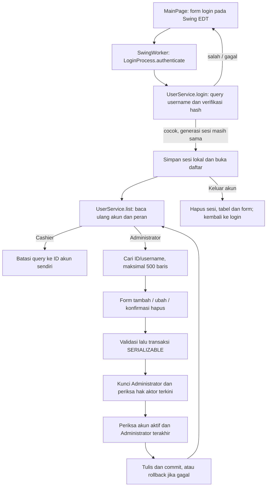

# Alur kode ApotekKita Java

Aplikasi Swing ini menyediakan login dan pengelolaan akun user. Administrator mengelola akun; Cashier melihat profil sendiri. Tidak ada alur stok obat atau transaksi apotek dalam source aplikasi ini.

| Bagian | Sumber |
| --- | --- |
| Jendela, form dan pekerjaan background | [GUI/MainPage.java](../src/main/java/GUI/MainPage.java) |
| Adapter login asal | [JAVA/LoginProcess.java](../src/main/java/JAVA/LoginProcess.java), [GUI/Login.java](../src/main/java/GUI/Login.java) |
| Login, sesi, pencarian dan perubahan akun | [apotek/UserService.java](../src/main/java/apotek/UserService.java) |
| Model serta validasi akun | [apotek/User.java](../src/main/java/apotek/User.java) |
| Hash dan verifikasi password | [apotek/Passwords.java](../src/main/java/apotek/Passwords.java) |
| Environment/properti dan koneksi JDBC | [DB/DatabaseConnection.java](../src/main/java/DB/DatabaseConnection.java) |
| Setup eksplisit pada database kosong | [apotek/DatabaseSetup.java](../src/main/java/apotek/DatabaseSetup.java), [schema.sql](../src/main/resources/database/schema.sql) |

## Login dan pembacaan

`MainPage.login()` mengambil input dan menjalankan autentikasi lewat `SwingWorker`. `LoginProcess` meneruskan ke service yang sama dengan jendela. `UserService.login()` mengosongkan sesi lama dan menambah nomor generasi percobaan. Query berparameter mengambil satu akun serta hash password. Sesi baru hanya dipasang jika password cocok dan generasi belum berubah; logout atau percobaan login lain tidak boleh dipulihkan oleh hasil login lama. Array password dibersihkan dalam `finally`.

`list()` meminta sesi, membaca ulang akun dari database, lalu memeriksa generasi sesi sebelum memperbarui informasi akun lokal. Peran terbaru menentukan query: Cashier dibatasi ke ID sendiri, Administrator dapat mencari ID/username. Pencarian memakai parameter `LIKE`; `%` dan `_` mengikuti perilaku wildcard SQL pada aplikasi ini. JDBC membatasi hasil menjadi 500 baris. Kolom password tidak diambil ke `User` atau tabel tampilan.

## Menyimpan dan menghapus

Form membuat `User` yang memvalidasi ID, username, gender, tanggal, telepon, email, alamat dan role. Akun baru membutuhkan password; pada perubahan akun, kedua kolom password kosong mempertahankan hash sebelumnya. Password yang diisi harus lolos aturan hash dan konfirmasi form.

`save()` dan `delete()` memeriksa sesi Administrator, membuka transaksi `SERIALIZABLE`, lalu mengunci baris Administrator dengan urutan ID yang tetap. Aktor harus masih berada pada daftar Administrator database. Pemeriksaan ini tidak bergantung hanya pada tombol yang terlihat di jendela.

Penghapusan akun yang sedang digunakan ditolak. Penurunan role akun sendiri ditolak. Perubahan/penghapusan yang akan menghilangkan Administrator terakhir juga ditolak. Penulisan memakai parameter JDBC; commit dilakukan setelah satu baris berhasil diubah. Kegagalan query atau validasi memicu rollback. UI memuat ulang daftar sesudah service mengembalikan hasil sukses; tidak ada pengulangan otomatis operasi tulis.

## Tampilan, setup dan batas

Pekerjaan JDBC berlangsung di `SwingWorker`; perubahan komponen dan pesan kembali ke EDT. Daftar kosong memiliki pesan khusus. Input salah dan kegagalan akses menampilkan alasannya; kegagalan database menampilkan pesan pemulihan, sementara log hanya mencatat SQLState dan kode error. `logout()` menghapus sesi serta menaikkan generasinya; jendela membersihkan baris, pencarian dan form.

`DatabaseSetup --empty-demo-database` adalah jalur terpisah untuk membuat tabel dan Administrator awal dengan data contoh. Startup jendela tidak menjalankannya. Setup tidak menimpa tabel yang sudah ada; ia bukan migrasi data lama. JDBC membaca environment atau properti proses, tidak memuat `.env` otomatis.

Aplikasi terhubung langsung ke MySQL memakai satu akun database. Pemeriksaan service mengatur alur di dalam aplikasi; pemegang kredensial MySQL tetap dapat mengakses database di luar jendela. Ini bukan server autentikasi atau pemisahan izin SQL per pengguna.

[UserServiceTest](../src/test/java/apotek/UserServiceTest.java) menguji kontrak service pada H2, [DesktopTest](../src/test/java/GUI/DesktopTest.java) menjalankan aksi dan ekspor tampilan Swing pada EDT, sedangkan [MySqlIntegrationTest](../src/test/java/apotek/MySqlIntegrationTest.java) memerlukan aktivasi sengaja dan database demo MySQL sesuai README. Perubahan dokumentasi ini tidak menjalankan ulang tes yang source-nya tetap sama.
